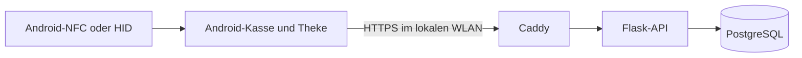

# Architektur · Der Odentaler

## Android

Die App behält Kotlin, AppCompat/Material 3 und XML. Der Scanner liefert kanonische NFC-Kennungen aus Android ReaderMode oder einem explizit gewählten HID-Profil. Die Anzeige führt den aktiven Verkauf und kommuniziert über den versionierten REST-Vertrag. Android zeigt eine Buchung erst nach einem eindeutigen Serverergebnis als erfolgreich an. Die Vorgangs-ID dient zur Klärung einer unterbrochenen Antwort. UID-basierte Armbänder liefern eine Kennung. Ein späterer authentifizierter Medienadapter kann darüber hinaus einen Nachweis liefern.

## Backend

Flask übernimmt die Rollen- und Ereignisprüfung vor dem Zugriff auf PostgreSQL. Die Datenbank ist für Guthaben, Transaktionen sowie Produktpreise beim Buchen verbindlich. Der Buchungsendpunkt prüft Positionszahlen, Session und Angebot und verwendet eine Vorgangs-ID mit festgehaltenem Ergebnis. Gleiche IDs müssen dieselbe Absicht bezeichnen. Eine Verbindung zu einem öffentlichen Dienst ist im laufenden Betrieb nicht erforderlich.

Kassenaufladung, Rückzahlung und Warenverkauf werden im Journal unterschieden. Für Berichte werden Geldzufluss, Produktumsatz und verbliebenes Guthaben getrennt betrachtet. Bonverkauf, Zahlungsdienstleister, Kassenabschluss und weitere Verwaltungsoberflächen sind eigene Ausbaustufen.

## Betriebsgrenzen

Der Betrieb benötigt eine Verbindung zum lokalen Backend. Beim Ausfall kommt als nächster zulässiger Schritt die Klärung des gespeicherten Vorgangs über die API infrage. Ein Offline-Journal auf dem Gerät ist nicht vorgesehen. TLS endet am Reverse Proxy. Gerätezugänge sind wie Zugangsdaten zu behandeln. Die Trust-Konfiguration und die Schutzanforderungen bei Bestandsmigration und Wiederanlauf stehen in [DEPLOYMENT.md](DEPLOYMENT.md).
